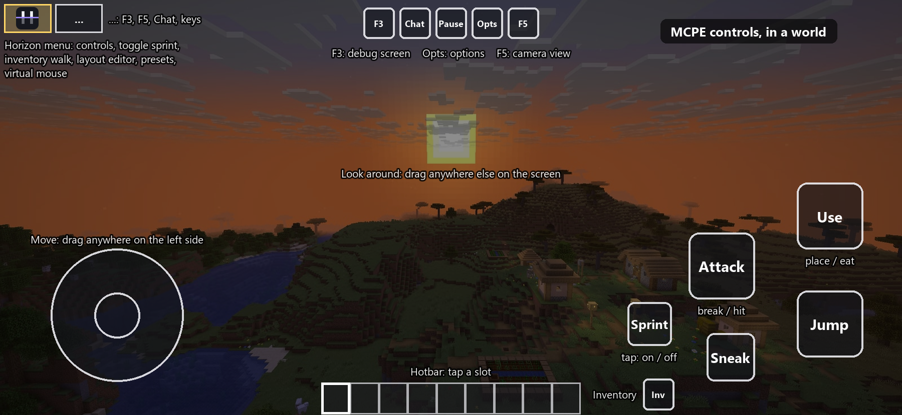
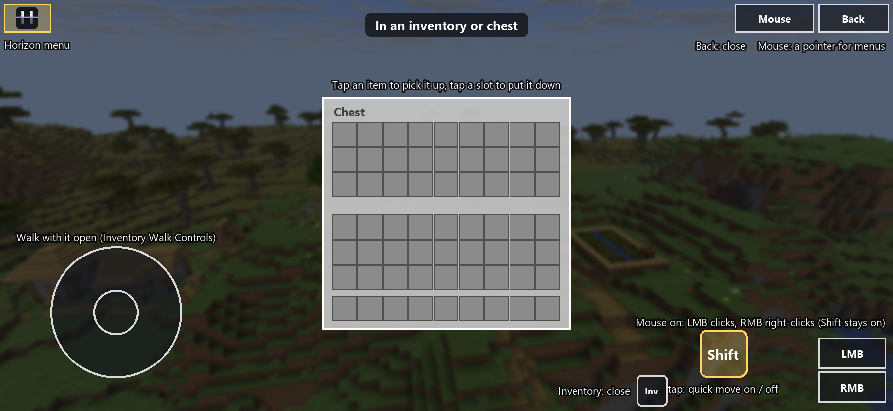

  
  
  
  
  
  

  <a href="#install"><b>Install</b></a> ·
  <a href="#controls"><b>Controls</b></a> ·
  <a href="#shader-packs"><b>Shader packs</b></a> ·
  <a href="#native-mods"><b>Native mods</b></a> ·
  <a href="#tips-and-troubleshooting"><b>Help</b></a> ·
  <a href="#build-it-yourself"><b>Build it yourself</b></a> ·
  <a href="docs/ios.md"><b>iOS guide</b></a>

# Horizon Pocket Edition (iOS)

**Minecraft: Java Edition 26.3 on iPhone and iPad, running natively.** Horizon Pocket Edition
("Horizon PE" under its icon) is an iOS port of [Horizon](https://github.com/ludovic111/horizon),
Minecraft's Java game rewritten in Rust, which reads the same worlds, follows the same rules and
generates the same terrain as Java Edition. It is based on [Starling](https://github.com/starling-client/starling),
Horizon's Android port. There is no Java virtual machine and no OpenGL translation in between: the game
draws with Metal, so it starts fast and plays smoothly on a phone.

From Starling it keeps everything made for phones (the touch controls, accounts, skins, catalog and
shader packs), and adds what iOS needs on top: the game files laid out without Java, the Files app,
Photos, the iOS keyboard, Keychain sign-ins, and native mods compiled into the app itself.

> **Not an official Minecraft product.** Not approved by or associated with Mojang or Microsoft.
> Minecraft and "Pocket Edition" are Mojang's trademarks. This app contains no Minecraft code, assets
> or data: it downloads the game's files from Mojang on your phone, and you need your own copy of
> Minecraft: Java Edition 26.3 to play online.

<table>
  <tr>
    <td></td>
    <td></td>
    <td></td>
  </tr>
  <tr>
    <td></td>
    <td></td>
    <td></td>
  </tr>
</table>

Screenshots of Horizon's game, from the Starling project.

## Install

**You need** an iPhone or iPad on iOS 16 or newer (iPhone 8 and later), about 2 GB free, and a way
to sideload apps: [SideStore](https://sidestore.io), [AltStore](https://altstore.io),
[Sideloadly](https://sideloadly.io) from a computer, or [LiveContainer](https://github.com/LiveContainer/LiveContainer).

1. **Get the app**, one of two ways:
   - **Just to play: a ready build.** Open this repository's [Actions](../../actions/workflows/ios.yml),
     pick the latest run with a `horizon-pe-ios-<number>` artifact, and download it (any GitHub account
     can; GitHub asks you to sign in). Unzip it to get `HorizonPE-iOS-unsigned.ipa`. Everything works in
     it, except building native mods: that needs the second way.
   - **Your own copy, for native mods.** Fork this repository and build the app in your fork: the
     steps are under [Native mods](#native-mods), step 1. It takes one tap on GitHub and about an hour
     of waiting, and costs nothing.
2. **Sideload it.** Open the `.ipa` with your sideloading app, or drop it on Sideloadly. The `.ipa` is
   unsigned: the sideloading app signs it with your Apple ID. With a free Apple ID the signature lasts
   7 days; refresh it (SideStore and AltStore do that for you) and nothing is lost.
3. **Set it up.** On the first start, sign in with Microsoft (the account that owns Java Edition),
   Ely.by, or pick an offline profile. The game downloads its files from Mojang, checks each one, and
   lays them out on the phone, once (keep the app open and on Wi-Fi). Then the title screen.

**Updating:** install a newer `.ipa` the same way, over the one you have. It is the same app, so your
worlds, settings, accounts and mods stay. Coming from Horizon's own iOS app? The setup offers to copy
its worlds and resource packs over.

Your game folder is **On My iPhone > Horizon PE** in the Files app: worlds (`saves`), resource packs,
shader packs, mods, screenshots and logs. Open a pack, a world, a skin or a mod (`.zip`, `.starling`,
`.mrpack`, `.hmod`, `.hnmod`, `.png`) with Horizon PE from Files or Safari to add it.

## Controls

The touch controls come in two styles: **MCPE** (the default, laid out like Minecraft Pocket Edition)
and **GoyControl** (your own buttons, each sending up to three keys). A hardware keyboard, mouse or
game controller takes over the moment you use it, and the touch controls come back when you touch
the screen.

| Control | What it does |
| --- | --- |
| **Movement stick** | Put a finger down anywhere on the left side and drag. With **Auto Sprint** on (Options > Controls), pushing it to the edge sprints |
| **Look around** | Drag anywhere that isn't a button |
| **Attack** / **Use** | Break and hit; place, eat, open. Hold Attack to keep breaking |
| **Jump** / **Sneak** | Jump and sneak; while swimming or flying they go up and down, and Sneak gets off a mount |
| **Sprint** | Tap to start sprinting, tap again to stop (**Toggle Sprint**, on by default). Turn it off to hold instead |
| **Inventory** | Opens the inventory; tap it again to close |
| **F3, Chat, Pause, Options, F5** | The debug screen, chat, the pause menu, the game's Options, and the camera view |
| **Horizon menu** (the Horizon logo, top left) | Touch settings and the layout: see below |
| **...** (top left) | A row of F3, F5, Chat and Keys, plus Hold F3 and the F3 combinations (F3 + B, G, H...) |
| **Hotbar** | Tap a slot to select it |

**In an inventory or chest:** tap an item to pick it up, tap a slot to put it down. The MCPE layout
keeps two buttons there:

- **Shift** (Sneak's place, with a Shift arrow): tap it to turn Shift on (the arrow fills in), then
  tap items to **quick move** them between the chest and your inventory. Tap Shift again to turn it
  off; closing the inventory turns it off too.
- **Inventory** closes it, like **Back** in the top right corner.

With **Inventory Walk Controls** on (the default), the movement stick stays, so you can walk with the
inventory open. **Mouse** (turn on **Virtual Mouse Button** in the Horizon menu) shows a pointer for
menus, moved by dragging, with **LMB** and **RMB** for left and right clicks; Shift stays on while
you click with them, so they quick move too.

**The Horizon menu** (the Horizon logo in the top left corner) holds the touch settings, in five
tabs:

- **Recommended:** the most used settings in one place: resolution, look sensitivity, the virtual
  mouse, the style and animations.
- **Controls:** the style (MCPE or GoyControl), presets, and the layout editor (move, resize, recolour,
  hide or rebind every button, with snap to grid); look sensitivity, invert Y, and split touch (a
  crosshair instead of tapping where you aim).
- **Aiming:** the movement and aim mode, where the movement stick can start, the virtual mouse's speed
  and pointer size, and gyroscope aiming.
- **Buttons:** button size, the offhand (Swap) button, a separate Shield button, left-handed layout,
  **Toggle Sprint** and **Inventory Walk Controls**.
- **Advanced:** vibration, auto-jump, and keys for a desktop shortcut or your own input.

These are Horizon's own settings, kept in `horizon-touch.json` and in your presets. The game's
**Options > Controls** has Minecraft's settings (key binds, mouse sensitivity, Sneak and Sprint as
Hold or Toggle for a keyboard), which are separate.

## Shader packs

Shader packs for Iris and OptiFine work: Complementary, MakeUp, BSL, Photon and many more. Get them
from the catalog on the **Shader Packs** screen, or put a pack's `.zip` in the `shaderpacks` folder in
Files. **Starling Visuals**, a shader pack made for phones, comes with the app.

**Turning one on takes a moment, and that's normal.** A shader pack is a set of programs written for
desktop OpenGL; when it loads, the game translates every one of them for Metal and the GPU driver
compiles them. A light pack takes a few seconds, a large one (Complementary, Photon) can take longer.
After that it plays at full speed. Heavier packs cost frame rate, battery and heat; Starling Visuals
and the **Auto** profile are tuned for phones.

## Native mods

Native mods change the game's own code. iOS runs no code its app didn't ship with, so on iOS a
native mod is **compiled into the app**: GitHub builds you a new `.ipa` with the mods you picked, and
you install it over the old one. Your worlds and settings stay. You pick the mods in the game, and
GitHub does the work while you play.

Builds run in the GitHub repository the app was built from, and only that repository's owner can start
them. So you need **your own fork**, and the app built from it. Steps 1 and 2 are once only.

**1. Your own copy (once).**

1. Sign in to [GitHub](https://github.com) (Safari is fine), open this repository and tap **Fork**,
   then **Create fork**. Keep it public: GitHub's macOS machines are free for public repositories.
2. In your fork, open the **Actions** tab and tap **I understand my workflows, go ahead and enable
   them** (GitHub asks once for a new fork).
3. **Actions > ios > Run workflow**, tick **Make and keep the unsigned .ipa**, and tap **Run workflow**.
   About 40 to 60 minutes later the run has a `horizon-pe-ios-<number>` artifact. Download it, unzip it,
   and install `HorizonPE-iOS-unsigned.ipa` (see [Install](#install)). This app builds mods in your
   fork.

**2. A GitHub token (once a year).** The game needs your permission to start builds in your fork:

1. In the game, Options > Mods, tap **Make a token**. GitHub's token form opens, filled in: its name,
   one year, and the permission **Actions: Read and write**. (The same form:
   [this link](https://github.com/settings/personal-access-tokens/new?name=Horizon+PE&description=Builds+native+mods+from+the+game&expires_in=365&actions=write).)
2. Under **Repository access** choose **Only select repositories** and pick your fork.
3. Tap **Generate token**, and copy it: GitHub shows it once.
4. Back in the game, tap **Paste GitHub token**. It stays in your phone's Keychain and only ever goes
   to GitHub.

**3. Build.**

1. Options > Mods > **Catalog**: install the native mods you want.
2. The Mods page says which native mods this app has, and that the ones you turned on aren't all in
   it. Tap **Build on GitHub**.
3. Keep playing. About 30 to 60 minutes later a toast and a line at the top of the title screen say
   **Mods ready: install** (or **Mods build failed**, with why).
4. Tap it: **Install...** opens the share sheet. Pick SideStore, AltStore, LiveContainer or your
   signer, and install it over the app you have.

**Removing a native mod** turns it off at once, and it leaves the app with your next build. Rather
not build again? Leave it installed and turn it off in Options > Mods instead.

**Getting updates in your fork.** A fork doesn't follow this repository by itself. On your fork's
page on GitHub, tap **Sync fork > Update branch**, then build again: **Build on GitHub** in the game
(it builds your mods into the newest version), or **Actions > ios > Run workflow** for the app alone.

**Without the game:** in your fork, **Actions > ios > Run workflow**, and type the mod ids in **Native
mods to build in** (for example `wrench fps_overlay`). The run's artifact,
`horizon-pe-ios-<number>-native-mods`, is the app with them.

<b>If a build doesn't work</b>

- **"GitHub refused (403)" or "(404)":** the token can't start builds in the repository this app was
  built from. Make it for your fork, with **Actions: Read and write**, and use the app built from your
  fork (step 1), not a ready build from someone else's repository.
- **"Mods build failed":** open the run in your fork's **Actions** tab to see which step failed. A mod
  that doesn't fit this version of the game fails there, before anything reaches your phone.
- **The token expired** (after a year): **Make a token** again, then **Paste new token**.
- **Nothing starts in your fork:** workflows aren't enabled yet (step 1.2).

Every build is checked before it reaches you: each mod is downloaded from the registry's own releases
and checked against its size and SHA-256, applied to the source the way Starling's own mod builds do,
compiled, and started once in the iOS Simulator. Builds stay in your fork's Actions for 30 days and are
never published as releases, but anyone signed in to GitHub can download a public repository's run
artifacts: they hold the game and the mods you picked, nothing of yours. All of it in detail:
[docs/ios.md](docs/ios.md#native-mods).

## What works

- **The game:** singleplayer with Java's world generation, mobs, villagers, raids, redstone, every
  command, the HUD and the recipe book, on saves in Java's format. Worlds from older versions are
  upgraded as Java does.
- **Touch controls:** every action on screen in MCPE or GoyControl style, with presets, a layout
  editor, the Horizon menu, a virtual mouse for menus, a keypad, Shift for quick moves in
  inventories, walking with an inventory open, and optional gyroscope aiming ([Controls](#controls)).
- **Keyboard, mouse and controllers:** a hardware keyboard or mouse takes over the moment you use it;
  game controllers work through iOS's GameController. The on-screen keyboard opens on any text field
  and closes with a tap beside it.
- **Accounts:** Microsoft, Ely.by and offline profiles, several of each, switched from the title
  screen's corner. Sign-ins are kept in the iOS Keychain.
- **Skins:** your profile's skin and cape, and Skin Customization to change them.
- **Catalog:** mods, resource packs and shader packs from Horizon's registry and Modrinth, installed
  with one tap from Options > Mods, Resource Packs or Shader Packs, with their pictures. Each shelf's
  **Installed** view lists everything you have there (from the catalog or the Files app) and removes
  it.
- **Shader packs:** Iris and OptiFine packs, translated for Metal when they load, and Starling Visuals
  ([Shader packs](#shader-packs)).
- **Servers:** online and offline-mode servers, proxies, server resource packs, plugin servers'
  dialogs, custom items and models, LAN worlds and invites.
- **Made for the phone:** settings picked for your device, a memory governor that keeps the game
  inside what iOS allows, ProMotion up to 120 Hz, screenshots (F2) saved to Photos, and a diagnostic
  ZIP (Options > Diagnostics) to send with a bug report.

### Different from Starling on Android

| Starling (Android) | Horizon PE (iOS) |
| --- | --- |
| A Java runtime prepares the game files on the phone | iOS runs no Java: the app carries the tables Java makes (built by GitHub), and lays the downloaded files out with them, file for file the same |
| Native mods: a library from Starling's build server, swapped in | Native mods are compiled into the app by GitHub Actions ([above](#native-mods)) |
| The `Starling` folder in shared storage | **Horizon PE** in the Files app |
| In-app APK updates | A new `.ipa`, installed over the old one |

## Tips and troubleshooting

- **The app stopped opening after a week.** A free Apple ID signs apps for 7 days. Refresh it in
  SideStore or AltStore (they can do it in the background), or sideload the `.ipa` again. Nothing is
  lost.
- **Moving worlds in or out.** Worlds are folders in `saves` (Files > On My iPhone > Horizon PE). Copy
  a Java Edition world's folder in, or a `.zip` of it opened with Horizon PE.
- **Low frame rate or a hot phone.** Lower the render distance in Options > Video Settings, try
  Starling Visuals or no shader pack, and close other apps. The game already picks settings for your
  device.
- **Reset the touch layout.** Horizon menu > Controls: pick the **Default** preset.
- **The game crashed or something looks wrong.** Options > Diagnostics > **Export diagnostic ZIP**,
  then [open an issue](../../issues/new/choose) with it and what you were doing. The ZIP stays on your
  phone until you share it; look through it first.

## Build it yourself

You don't need a Mac: GitHub's Macs build it, in your fork ([Native mods](#native-mods), step 1).

Every push to `main` runs the same build without keeping the `.ipa`: the game compiled for iOS and
linted, the game files prepared and proved to come out the same on the phone, the app bundled and
checked to carry none of Mojang's files, and the app started in the iOS Simulator
([`ios.yml`](.github/workflows/ios.yml)). [`ios-guard.yml`](.github/workflows/ios-guard.yml) checks that
the iOS work leaves Starling's desktop and Android builds compiling and formatted.

**On a Mac with Xcode:** `rustup target add aarch64-apple-ios`, then `python3 tools/ios_prepare.py`
(with Java 25: it fetches the pinned official 26.3 files, checks them, and makes the game tables the app
carries), then `brew install xcodegen && cd packaging/ios && xcodegen generate` and open
`StarlingIOS.xcodeproj`. Its build phase compiles the Rust game with Cargo and puts it in the app.

## How the repository is laid out

The repository is Starling's source (Horizon with Starling's Android port) with an iOS layer on top;
[IOS-SYNC.md](IOS-SYNC.md) records the Starling version it is based on, every change to Starling's own
files, and how to take in a new Starling release.

| Path | What it is |
| --- | --- |
| `crates/horizon-ios-game` | The app's program: its folders, the 16 MB stack the game runs on, the event loop |
| `crates/horizon-gamecontroller` | Every UIKit, GameController, Keychain, CoreMotion and Photos call (the game crates forbid unsafe code) |
| `crates/horizon-client/src/ios.rs` | The game's iOS hooks: files, Keychain sealing, the keyboard, haptics, gyroscope, imports |
| `crates/horizon-client/src/game/native_builds_ios.rs` | Native mods built on GitHub from the Mods page |
| `crates/horizon-ios-prepare` | Lays the game files out on the phone without Java |
| `packaging/ios` | The Xcode project (XcodeGen), `Info.plist`, icon, and the native-mod staging script |
| `tools/ios_prepare.py`, `tools/ios_native_mods.py` | The game tables made in CI; native mods fetched and checked |
| `third_party/winit` | Starling's winit with the iOS patches (scenes, keyboard and mouse, opened files) |
| Everything else | Starling and Horizon, as they are ([Starling's README](https://github.com/starling-client/starling#readme)) |

## Credits

- **[Horizon](https://github.com/ludovic111/horizon)** by Ludovic and its contributors: the game this
  app ports, Minecraft: Java Edition rewritten in Rust.
- **[Starling](https://github.com/starling-client/starling)**, formerly Horizon Android, by
  [JuanLuci](https://github.com/JuanLuci) and [Vasysik](https://github.com/Vasysik): Horizon's Android
  port, which this app is based on, with its touch controls, accounts, catalog, skins and Starling
  Visuals.
- **[horizon-iOS](https://github.com/meehandaniel4/horizon-iOS)**: the first native mod builds for
  iOS on GitHub Actions, which this app's follow.

## License

MIT, as Horizon and Starling: see [LICENSE](LICENSE). Third-party code and its licences are listed in
[THIRD_PARTY_NOTICES.md](THIRD_PARTY_NOTICES.md).
