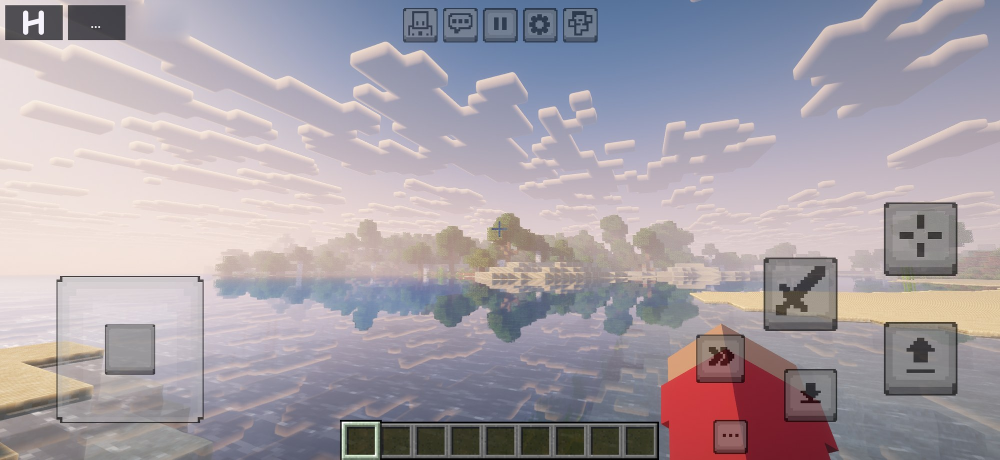
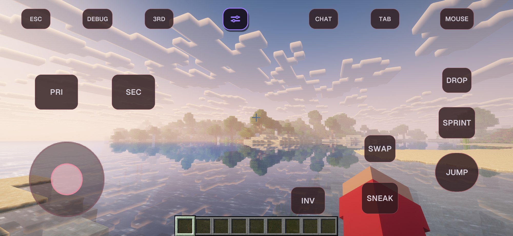

  
  
  
  
  

# Horizon Pocket Edition (iOS)

**Minecraft: Java Edition 26.3 on iPhone and iPad, running natively.** Horizon Pocket Edition
("Horizon PE" on your home screen) is an iOS port of [Horizon](https://github.com/ludovic111/horizon),
Minecraft's Java game rewritten in Rust, based on [Starling](https://github.com/starling-client/starling),
Horizon's Android port. It plays the same worlds, rules and terrain as Java Edition, and draws with
Metal: no Java, no emulation.

> **Not an official Minecraft product.** Not approved by or associated with Mojang or Microsoft. The
> app contains no Minecraft code or assets: it downloads the game's files from Mojang on your phone.
> To play online you need your own copy of Minecraft: Java Edition.

<table>
  <tr>
    <td></td>
    <td></td>
    <td></td>
  </tr>
  <tr>
    <td></td>
    <td></td>
    <td></td>
  </tr>
</table>

**Contents:** [Install](#install) · [Controls](#controls) · [Shader packs](#shader-packs) ·
[Native mods](#native-mods) · [Help](#help) · [For developers](#for-developers) · [Credits](#credits)

## Install

**You need** an iPhone or iPad on iOS 16 or newer (iPhone 8 and later), about 2 GB free, and a
sideloading app: [SideStore](https://sidestore.io), [AltStore](https://altstore.io),
[Sideloadly](https://sideloadly.io) (from a computer) or [LiveContainer](https://github.com/LiveContainer/LiveContainer).

1. **Download the app.** Open [Actions > ios](../../actions/workflows/ios.yml), pick the newest run
   that has a `horizon-pe-ios-<number>` artifact, and download it (GitHub asks you to sign in). Unzip it
   to get `HorizonPE-iOS-unsigned.ipa`.
   *Want native mods? Build the app in your own fork instead: [Native mods](#native-mods), step 1.*
2. **Install it** with your sideloading app. It signs the app with your Apple ID; with a free Apple ID,
   refresh it every 7 days (SideStore and AltStore do it for you). Nothing is lost.
3. **Start it.** Sign in with Microsoft (the account that owns Java Edition) or Ely.by, or play
   offline. The first start downloads the game's files from Mojang, so stay on Wi-Fi.

**Updating:** install the newer `.ipa` over the old one. Worlds, settings, accounts and mods stay.

**Had a build from before the rename?** Older builds used the app ID `dev.horizon.starling`; now it is
`dev.horizon.pocketedition`, so iOS installs the new one as a separate app. Start the new app once,
then in the Files app copy `saves` (and `resourcepacks`, `shaderpacks` if you like) from the old app's
**Horizon PE** folder into the new one's (the nearly empty one), and delete the old app. Sign in again
in the new app.

**Your files** are in the Files app under **On My iPhone > Horizon PE**: `saves` (worlds),
`resourcepacks`, `shaderpacks`, `mods`, `screenshots` and `logs`. Open a world, pack, skin or mod
(`.zip`, `.mrpack`, `.hmod`, `.hnmod`, `.png`) with Horizon PE from Files or Safari to add it.

## Controls

Two touch styles: **MCPE** (the default, like Minecraft Pocket Edition) and **GoyControl** (labelled
buttons you place and bind yourself). A keyboard, mouse or game controller works too; the touch
controls step aside while you use one.

| Button (MCPE) | What it does |
| --- | --- |
| **Pad** (bottom left) | Move. Put a finger down anywhere on the left side and drag |
| **Sword** / **crosshair** | Attack (break, hit; hold to keep breaking) / Use (place, eat, open) |
| **Up arrow** / **down arrow** | Jump / sneak. Up and down while swimming or flying; sneak gets off a mount |
| **Double arrow** | Sprint: tap on, tap off. Turn **Toggle Sprint** off in the Horizon menu to hold it instead |
| **...** (by the hotbar) | Inventory |
| **Top row** | Debug screen (F3), chat, pause, Options, camera view (F5) |
| **H** (top left) | The Horizon menu: touch settings and the layout editor |
| **...** (top left) | F3, F5, Chat and Keys, plus the F3 combinations |

Drag anywhere else to look around; tap a hotbar slot to select it.

**In an inventory or chest:** tap an item to pick it up, tap a slot to put it down. The sneak button
becomes **Shift** (its arrow fills in when on): with Shift on, tapping an item **quick moves** it.
You can keep walking with the inventory open (**Inventory Walk Controls**). With the virtual mouse
(turn on **Virtual Mouse Button** in the Horizon menu), **Mouse** shows a pointer for menus, and
**LMB** / **RMB** click with it; they quick move too while Shift is on. **Back** (top right) closes
any screen.

**GoyControl** labels every button: **PRI** / **SEC** (attack / use), **JUMP**, **SNEAK**, **SPRINT**,
**INV**, **DROP**, **SWAP** (hands), **CHAT**, **TAB** (player list), **DEBUG** (F3), **3RD** (camera
view), **ESC** and **MOUSE**. The sliders button is the Horizon menu; drag it where you like.

**The Horizon menu** (**H**, or the sliders button) is where the touch settings are:

- **Controls:** switch MCPE / GoyControl, presets, the layout editor (move, resize, recolour, hide or
  rebind any button), look sensitivity, invert Y.
- **Aiming:** aim mode, where the movement pad can start, virtual mouse speed, gyroscope aiming.
- **Buttons:** button size, the Swap and Shield buttons, left-handed layout, **Toggle Sprint**,
  **Inventory Walk Controls**.
- **Recommended** has the most used of these in one place; **Advanced** has vibration and auto-jump.

Minecraft's own **Options > Controls** (key binds, and Sneak / Sprint toggles for a keyboard) is
separate.

## Shader packs

Iris and OptiFine shader packs work (Complementary, BSL, MakeUp, Photon and more). Install them from
the catalog on the **Shader Packs** screen, or put the `.zip` in `shaderpacks` in Files. **Starling
Visuals**, made for phones, comes with the app.

**Turning a pack on takes a few seconds, and that's normal:** every program in it is translated for
Metal and compiled, once, as it loads. Big packs take longer and cost more frame rate and battery;
Starling Visuals and the **Auto** profile are the light options.

## Shared worlds

A shared world belongs to your group, not to one of you. Whoever opens it while nobody is
playing hosts it on their own phone; friends join them with no server. When the host leaves,
the world moves to a player who is still in it, and everyone else follows by themselves. The
title screen's **Shared Worlds** (where Realms was) lists your shared worlds and how many are in
each one right now.

The world always runs on the host's phone, as single player does, so it plays as fast. A copy
of it lives in a storage bucket your group owns, which is how the next host gets the newest
version. Everyone needs a **Microsoft account** signed in: it is how each game knows who you are,
so your inventory, pets and stats stay yours whoever hosts.

### Set up the storage once (about 10 minutes, on your phone)

The world's copy goes in **Cloudflare R2**: 10 GB free, which holds many worlds. R2 asks for a
payment card when you turn it on; nothing is charged within the free amounts, and a group's
playing stays far inside them.

1. Open **dash.cloudflare.com** in your phone's browser and sign up (free).
2. Go to **R2 Object Storage**, turn it on, then **Create bucket**. Any name (`horizon-worlds`),
   location Automatic.
3. In R2, open **Manage API tokens** (API, Manage API tokens) and **Create API token**: permission
   **Object Read & Write**, applied to that bucket only. Create it, and keep the page open: it shows
   the **Access Key ID**, the **Secret Access Key** and the **S3 endpoint** (`https://...r2.cloudflarestorage.com`)
   once.
4. In the game: **Shared Worlds**, **Share a World...**, pick the world, then paste the endpoint, the
   bucket's name and the two keys (copy each from the browser, then **Paste** in the game), and
   **Share World**. The game first checks that the bucket keeps a world safe, then uploads it.
5. Open the world in the list, **Copy World Invite**, and send it to your friends in a private
   message. They tap **Add with Invite...**, **Paste**, **Add World**.

The invite holds the bucket's key: anyone who has it can play and change the world. Send it only
to the friends you play with. A second world can go in the same bucket: the game remembers it.

### Playing

- **Start** when nobody is playing: you host. **Join** when someone is: you join them.
- **Leaving as the host:** Save and Quit. The world uploads (a moment; keep the app open until it
  says so) and passes to a player who is still in it. Their game takes it and the others follow.
- **The invite code:** Game Menu, the Friends button shows the code that joins the host right now,
  with **Copy Code**. Friends with the world in their list never need it; anyone else can join
  with it as with Play with Friends, until the host changes.
- **Give Host:** Game Menu, the Friends button, **Give Host to ...**. **Ask to Host** does the same
  from a guest's side, and the host answers yes or no.
- **While you host,** the world's copy updates every 5 minutes, and whenever your app goes to the
  background, without stopping play.
- **If the host's phone dies or loses its connection,** the others wait up to about a minute and a
  half in case it comes back, then one of them takes the world from its last copy (at most 5
  minutes old). Nothing is damaged. What the old host did after that copy stays on their phone, as
  a separate singleplayer world named "(my own progress)".
- **If your phone can't reach the storage while you host,** the world pauses until it can, so
  nobody can take it over while you keep playing.

### Reaching the host

Each friend's game connects straight to the host's whenever it can, which is the fastest way:

1. **Directly:** on the same Wi-Fi or hotspot, through a router that opens a port (the game asks
   it by UPnP or NAT-PMP), or over a VPN such as Tailscale.
2. **Both at once:** when the host can't be called into (UPnP is off, or the host is on mobile
   data), the two games reach each other through **bore.pub**, a free public tunnel, and from
   there both dial the other at the same moment. Over IPv6 (most mobile networks and many home
   connections have it) and through most home routers, the two connections meet and the game goes
   straight between the phones: that friend leaves bore.pub at once.
3. **bore.pub:** only when neither works (both behind a carrier's shared address, with no IPv6)
   does a friend play through the tunnel. It can be slower, and it is run by volunteers. That
   friend and the host are told, and the host's Friends screen says why and how many friends
   connect each way. The world stays encrypted between the host and each friend either way.

Faster for everyone: a host on home Wi-Fi with UPnP on in the router; or, when the host is behind
the tunnel, **Give Host** to a player marked "(faster)", whose network takes direct connections.

### Good to know

- 8 players at most in a world.
- Removing a world from your list leaves it in the storage for the others; your copy becomes a
  normal singleplayer world.
- Old copies are kept for a while (the last 20, and one a day for two weeks), then removed.
- Shared worlds are between phones running this app. Friends on PC (official Horizon) are planned
  for later.

## Native mods

Native mods change the game's code, and iOS only runs code an app shipped with. So a native mod is
**built into the app**: GitHub compiles a new `.ipa` with the mods you pick, you install it over your
app, and your worlds stay. Builds run in the GitHub repository the app came from, and only its owner
can start them, so you need **your own fork** and the app built from it.

**1. Your own copy (once)**

1. On [GitHub](https://github.com) (signed in), open this repository and tap **Fork** > **Create
   fork**. Keep it public: then GitHub's build machines are free.
2. In your fork, open **Actions** and enable workflows (GitHub asks once).
3. **Actions > ios > Run workflow**, tick **Make and keep the unsigned .ipa**, run it. In about an hour
   the run has a `horizon-pe-ios-<number>` artifact: install that `.ipa` ([Install](#install)).

**2. A token (once a year)**

1. In the game, **Options > Mods > Make a token**. GitHub's token form opens, filled in (name, one
   year, **Actions: Read and write**).
2. Under **Repository access** pick **Only select repositories** and choose your fork.
3. **Generate token**, copy it (GitHub shows it once), and in the game tap **Paste GitHub token**.
   It stays in your phone's Keychain and only goes to GitHub.

**3. Build**

1. **Options > Mods > Catalog**: install the native mods you want.
2. On the Mods page, tap **Build on GitHub**, and keep playing.
3. In 30 to 60 minutes the title screen says **Mods ready: install**. Tap it, then **Install...**,
   and pick your sideloading app in the share sheet.

To **remove** a native mod, remove it and build again, or just turn it off in **Options > Mods**.
To **update**, tap **Sync fork > Update branch** on your fork's GitHub page, then build again.

<b>If a build fails</b>

- **"GitHub refused (403)" or "(404)":** the token isn't for the repository this app was built from.
  Make it for your fork with **Actions: Read and write**, and use the app built from your fork.
- **"Mods build failed":** open the run in your fork's **Actions** tab to see why. Usually a mod made
  for another game version; build again without it.
- **Token expired** (after a year): **Make a token**, then **Paste new token**.
- **Nothing starts:** workflows aren't enabled in your fork (step 1.2).
- **Without the game:** **Actions > ios > Run workflow** with mod ids in **Native mods to build in**
  (for example `wrench fps_overlay`).

Every mod is checked against the registry's size and SHA-256 before it is built, and every build is
started once in the iOS Simulator before you get it. Builds are kept in your fork's Actions for 30
days. More detail: [docs/ios.md](docs/ios.md#native-mods).

## Help

- **The app won't open after a week:** a free Apple ID signs apps for 7 days. Refresh it in SideStore
  or AltStore, or install the `.ipa` again. Nothing is lost.
- **Low frame rate or a hot phone:** lower the render distance (Options > Video Settings), use Starling
  Visuals or no shader pack, and close other apps.
- **Reset the touch layout:** Horizon menu > Controls > presets > **Default**.
- **Something crashed or looks wrong:** Options > Diagnostics > **Export diagnostic ZIP**, then
  [open an issue](../../issues/new/choose) with it and what you were doing.

## For developers

No Mac needed: GitHub builds the app. Every push to `main` compiles the game for iOS, lints it, prepares
the game files and checks the phone lays them out the same, bundles the app (checking it carries none
of Mojang's files) and starts it in the iOS Simulator ([`ios.yml`](.github/workflows/ios.yml));
[`ios-guard.yml`](.github/workflows/ios-guard.yml) checks Starling's desktop and Android builds still
compile. A run dispatched with **Make and keep the unsigned .ipa** keeps the app.

On a Mac with Xcode: `rustup target add aarch64-apple-ios`, `python3 tools/ios_prepare.py` (needs Java
25), then `brew install xcodegen && cd packaging/ios && xcodegen generate` and open
`HorizonPE.xcodeproj`.

[docs/ios.md](docs/ios.md) covers the iOS app in depth; [IOS-SYNC.md](IOS-SYNC.md) lists the Starling
version this is based on, the repository layout, every change to Starling's files, and how to take in
a new Starling release.

## Credits

- **[Horizon](https://github.com/ludovic111/horizon)** by Ludovic and contributors: Minecraft: Java
  Edition rewritten in Rust, the game this app ports.
- **[Starling](https://github.com/starling-client/starling)** by [JuanLuci](https://github.com/JuanLuci)
  and [Vasysik](https://github.com/Vasysik): Horizon's Android port, which this app is based on,
  with its touch controls, accounts, catalog, skins and Starling Visuals. The world screenshots above
  are Starling's.
- **[horizon-iOS](https://github.com/meehandaniel4/horizon-iOS)**: the first native mod builds for iOS
  on GitHub Actions.

## License

MIT, as Horizon and Starling: see [LICENSE](LICENSE) and [THIRD_PARTY_NOTICES.md](THIRD_PARTY_NOTICES.md).
